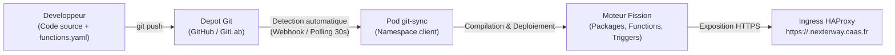
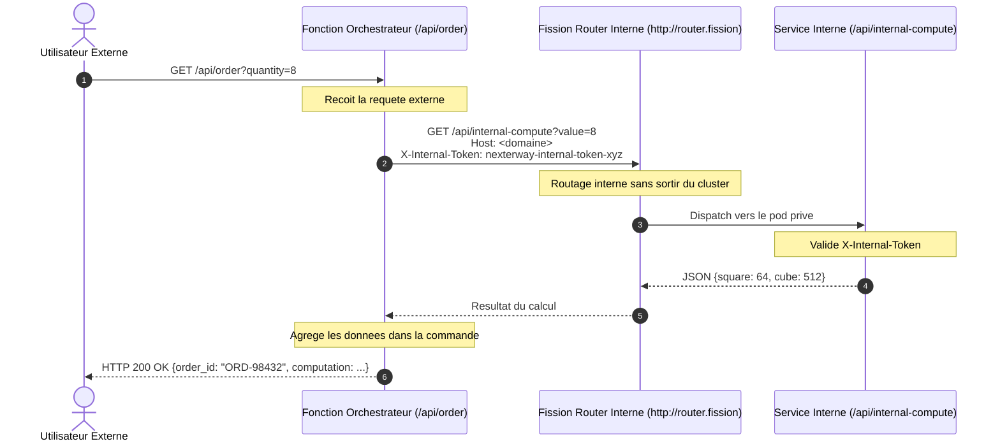

# Guide et Tutoriel Nexterway FaaS Serverless

Ce depot est un exemple de reference illustrant l'utilisation de la solution **Functions as a Service (FaaS)** Fission v1.27 sur la plateforme **Nexterway**.

Il presente la mise en oeuvre d'une approche **100% GitOps** pour deployer des fonctions dans 4 langages differents, securiser l'acces externe et orchestrer des communications securisees de service a service (inter-fonctions).

---

## Sommaire

1. [Principes de Fonctionnement (GitOps)](#1-principes-de-fonctionnement-gitops)
2. [Structure du Depot](#2-structure-du-depot)
3. [Declarer ses Fonctions (`functions.yaml`)](#3-declarer-ses-fonctions-functionsyaml)
4. [Tutoriel 1 : Runtimes Supportes (Node.js, Python, Go, Rust)](#4-tutoriel-1--runtimes-supportes-nodejs-python-go-rust)
5. [Tutoriel 2 : Proteger une Fonction depuis l'Exterieur (API Key)](#5-tutoriel-2--proteger-une-fonction-depuis-lexterieur-api-key)
6. [Tutoriel 3 : Securiser la Communication Entre 2 Fonctions](#6-tutoriel-3--securiser-la-communication-entre-2-fonctions)
7. [Synthese des Commandes de Test (curl)](#7-synthese-des-commandes-de-test-curl)
8. [Bonnes Pratiques de Production](#8-bonnes-pratiques-de-production)

---

## 1. Principes de Fonctionnement (GitOps)

Sur Nexterway FaaS, les developpeurs ne gerent ni Dockerfile, ni manifests Kubernetes (`Deployment`, `Service`, `Ingress`), ni cluster `kubectl`.



1. Vous modifiez votre code source dans ce depot.
2. Vous declarez ou ajustez la route dans `functions.yaml`.
3. Vous effectuez un `git push` sur la branche `main`.
4. L'agent `faas-git-sync` detecte le nouveau commit en quelques secondes, compile les dependances si necessaire, et actualise les routes HTTPS sans interruption de service.

---

## 2. Structure du Depot

```text
nexterway-faas-demo/
|-- functions.yaml                  # Fichier central de declaration des fonctions
|-- src/
|   |-- js/
|   |   `-- hello.js                # Fonction Node.js standard
|   |-- python/
|   |   |-- requirements.txt        # Dependances pip (requests, psutil)
|   |   |-- status.py               # Fonction Python avec dependances compilees
|   |   |-- secure_vault.py         # Exemple de fonction protegee par cle API
|   |   |-- internal_compute.py     # Service prive de calcul (inter-fonctions)
|   |   `-- order_processor.py      # Orchestrateur appelant le service interne
|   |-- go/
|   |   `-- handler.go              # Fonction Go compilee par go-builder
|   `-- rust/
|       `-- handler.rs              # Fonction Rust asynchrone (Axum)
`-- README.md                       # Ce document
```

---

## 3. Declarer ses Fonctions (`functions.yaml`)

Le fichier `functions.yaml` situe a la racine du depot liste toutes les fonctions a instancier sur la plateforme :

```yaml
functions:
  - name: greeting                  # Nom unique de la fonction
    runtime: nodejs                 # Runtime : nodejs, python, go, rust
    path: /api/greeting             # URL d'exposition HTTP
    method: GET                     # Methode HTTP : GET, POST, PUT, DELETE
    timeout: 30                     # Timeout d'execution en secondes
    file: src/js/hello.js           # Chemin du fichier source

  - name: system-status
    runtime: python
    path: /api/status
    method: GET
    timeout: 30
    file: src/python/status.py
```

---

## 4. Tutoriel 1 : Runtimes Supportes (Node.js, Python, Go, Rust)

### A. Node.js (`src/js/hello.js`)
Format standard CommonJS exportant une fonction `async` :

```javascript
module.exports = async function(context) {
    return {
        status: 200,
        body: JSON.stringify({
            message: "Hello World from Fission FaaS from NexterWay!",
            timestamp: new Date().toISOString()
        }),
        headers: { "Content-Type": "application/json" }
    };
};
```

### B. Python avec dependances externes (`src/python/`)
Si un fichier `requirements.txt` est present aux cotes du fichier Python, Fission lance automatiquement un build dans un pod `python-builder` pour installer les roues (`wheels`) :

```python
import psutil
import requests

def main():
    return {
        "status": "healthy",
        "cpu_percent": psutil.cpu_percent(interval=None)
    }
```

### C. Go compilable (`src/go/handler.go`)
Le code Go est compile a la volee par `go-builder` en plugin autonome. Il doit exporter le symbole `Handler` :

```go
package main

import (
    "encoding/json"
    "net/http"
)

func Handler(w http.ResponseWriter, r *http.Request) {
    w.Header().Set("Content-Type", "application/json")
    json.NewEncoder(w).Encode(map[string]string{
        "status": "healthy",
        "runtime": "golang",
    })
}
```

### D. Rust asynchrone (`src/rust/handler.rs`)
Le code Rust est compile par `rust-builder` avec le framework Axum et Tokio en mode binaire ultra-optimise :

```rust
use axum::response::IntoResponse;
use axum::Json;
use serde_json::json;

pub async fn handler() -> impl IntoResponse {
    Json(json!({
        "status": "healthy",
        "runtime": "rust-axum"
    }))
}
```

---

## 5. Tutoriel 2 : Proteger une Fonction depuis l'Exterieur (API Key)

### Le Besoin
Vous souhaitez exposer une API sur Internet tout en garantissant que seuls les clients autorises munis d'un secret partagé puissent la consommer.

### Le Principe
Le handler recoit la requete HTTP externe et verifie la presence d'un entete d'authentification (`X-API-Key` ou `Authorization: Bearer <token>`). Si la cle est manquante ou invalide, la fonction retourne un statut `HTTP 401 Unauthorized`.

### Implementation (`src/python/secure_vault.py`)
```python
import os
from flask import request, jsonify

# En production, ce secret peut provenir d'un Secret Kubernetes injecte en variable d'environnement
EXPECTED_API_KEY = os.getenv("API_KEY", "nexterway-secret-key-2026")

def main():
    # 1. Extraction de la cle API
    auth_header = request.headers.get("X-API-Key")
    if not auth_header:
        bearer = request.headers.get("Authorization", "")
        if bearer.startswith("Bearer "):
            auth_header = bearer[7:].strip()

    # 2. Verification
    if auth_header != EXPECTED_API_KEY:
        return jsonify({
            "status": "error",
            "code": 401,
            "message": "Acces refuse : cle API invalide ou absente (entete X-API-Key requis)"
        }), 401

    # 3. Reponse securisee
    return jsonify({
        "status": "success",
        "data": {
            "vault_item": "top-secret-credentials-alpha",
            "environment": "production"
        }
    }), 200
```

### Validation
- **Sans la cle API** (Refus immediat) :
  ```bash
  curl -i -k https://wy-3a1fd37f-1-0-0.nexterway.caas.fr/api/secure-vault
  # HTTP/2 401 Unauthorized
  ```
- **Avec la cle valide** (Succes) :
  ```bash
  curl -i -k -H "X-API-Key: nexterway-secret-key-2026" \
    https://wy-3a1fd37f-1-0-0.nexterway.caas.fr/api/secure-vault
  # HTTP/2 200 OK
  ```

---

## 6. Tutoriel 3 : Securiser la Communication Entre 2 Fonctions

### Le Besoin
Une architecture decoupee en micro-fonctions comprend generalement :
- Une **Fonction Passerelle / Orchestrateur** publique (`order-processor`), appelee par les utilisateurs ou le frontend.
- Un **Service Interne / Worker** prive (`internal-compute`), charge de realiser des operations sensibles ou des calculs metier lourds, qui **ne doit pas** pouvoir etre invoque directement depuis Internet.



### Etape 1 : Le Service Interne (`src/python/internal_compute.py`)
Ce service exige obligatoirement un jeton de service technique (`X-Internal-Token`). Tout appel direct sans ce token est rejete :

```python
import os
from flask import request, jsonify

INTERNAL_SERVICE_TOKEN = os.getenv("INTERNAL_SERVICE_TOKEN", "nexterway-internal-token-xyz")

def main():
    # Rejet systematique si le token interne est absent ou erronne
    token = request.headers.get("X-Internal-Token")
    if token != INTERNAL_SERVICE_TOKEN:
        return jsonify({
            "status": "error",
            "code": 401,
            "message": "Rejet : service interne non autorise. Entete X-Internal-Token requis."
        }), 401

    val = int(request.args.get("value", "10"))
    return jsonify({
        "service": "internal-compute",
        "input_value": val,
        "square": val * val,
        "cube": val * val * val,
        "processed_by_pod": os.getenv("HOSTNAME")
    }), 200
```

### Etape 2 : L'Orchestrateur Public (`src/python/order_processor.py`)
L'orchestrateur effectue l'appel interne vers `http://router.fission` via le reseau interne Kubernetes :

```python
import os
import json
import urllib.request
from flask import request, jsonify

INTERNAL_SERVICE_TOKEN = os.getenv("INTERNAL_SERVICE_TOKEN", "nexterway-internal-token-xyz")
ROUTER_URL = os.getenv("FISSION_ROUTER_URL", "http://router.fission")
TENANT_HOST = os.getenv("TENANT_HOST", "wy-3a1fd37f-1-0-0.nexterway.caas.fr")

def main():
    qty = request.args.get("quantity", "5")

    # Appel HTTP interne vers le service de calcul
    url = f"{ROUTER_URL}/api/internal-compute?value={qty}"
    req = urllib.request.Request(url, headers={
        "Host": TENANT_HOST,
        "X-Internal-Token": INTERNAL_SERVICE_TOKEN
    })

    with urllib.request.urlopen(req, timeout=10) as response:
        calc_data = json.loads(response.read().decode("utf-8"))

    # Agregation et reponse au client externe
    return jsonify({
        "status": "success",
        "order_id": "ORD-98432",
        "orchestrator_pod": os.getenv("HOSTNAME"),
        "computation": calc_data
    }), 200
```

### Validation
1. **Tentative d'appel direct du service interne par un tiers** :
   ```bash
   curl -i -k https://wy-3a1fd37f-1-0-0.nexterway.caas.fr/api/internal-compute
   # HTTP/2 401 Unauthorized
   ```
2. **Appel nominal via l'orchestrateur** :
   ```bash
   curl -i -k "https://wy-3a1fd37f-1-0-0.nexterway.caas.fr/api/order?quantity=8"
   # HTTP/2 200 OK
   # Le calcul (square: 64, cube: 512) est retourne de maniere transparente !
   ```

---

## 7. Synthese des Commandes de Test (curl)

Voici l'ensemble des commandes pour verifier les 7 fonctions actives du depot :

```bash
# 1. Node.js
curl -k https://wy-3a1fd37f-1-0-0.nexterway.caas.fr/api/greeting

# 2. Python avec psutil & requests
curl -k https://wy-3a1fd37f-1-0-0.nexterway.caas.fr/api/status

# 3. Go compile
curl -k https://wy-3a1fd37f-1-0-0.nexterway.caas.fr/api/go

# 4. Rust compile avec Axum
curl -k https://wy-3a1fd37f-1-0-0.nexterway.caas.fr/api/rust

# 5. Protection par cle API (echec sans cle)
curl -k https://wy-3a1fd37f-1-0-0.nexterway.caas.fr/api/secure-vault

# 6. Protection par cle API (succes avec cle)
curl -k -H "X-API-Key: nexterway-secret-key-2026" \
  https://wy-3a1fd37f-1-0-0.nexterway.caas.fr/api/secure-vault

# 7. Service interne direct (rejet 401)
curl -k https://wy-3a1fd37f-1-0-0.nexterway.caas.fr/api/internal-compute

# 8. Chaine complete securisee via Orchestrateur
curl -k "https://wy-3a1fd37f-1-0-0.nexterway.caas.fr/api/order?quantity=12"
```

---

## 8. Bonnes Pratiques de Production

1. **Ne pas versionner de secrets en dur** : Ne stockez jamais vos cles d'API ou jetons de production dans les fichiers sources ou dans Git. Utilisez les variables d'environnement alimentees par des `Secrets` Kubernetes.
2. **Cloisonnement reseau natif** : Le reseau Kubernetes du tenant est protege par les `NetworkPolicies` Nexterway. Aucun autre tenant ne peut emettre de requetes directes vers vos pods de fonctions.
3. **Timeouts et resilience** : Definissez toujours des valeurs de `timeout` raisonnables dans vos appels `urllib` ou `requests` (ex. 5 a 10 secondes) pour eviter de bloquer les pools de conteneurs Fission en cas de lenteur applicative.
