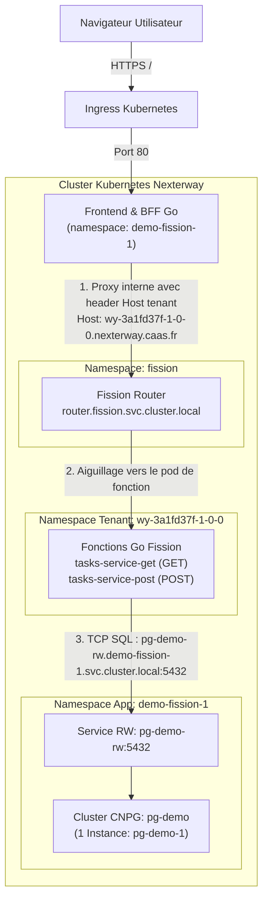

# Démo Complète Full Go : Frontend Web + Fission FaaS + PostgreSQL (CloudNativePG)

Ce projet illustre une architecture applicative complète **100% Go** exécutée sur Kubernetes :
- **Frontend / BFF en Go** (namespace `demo-fission-1`) : Serveur HTTP compilé en binaire statique Distroless, servant une interface Web moderne (Tailwind CSS) embarquée via `embed.FS` et agissant comme reverse-proxy vers le routeur Fission.
- **Fonctions Serverless Fission en Go** (namespace tenant `wy-3a1fd37f-1-0-0`) : Logique métier événementielle (`tasks-service-get` et `tasks-service-post`) qui reçoit les commandes, effectue les traitements et persiste l'état.
- **Base de données PostgreSQL opérée par CloudNativePG** (namespace `demo-fission-1`) : 1 instance managée via la CR `clusters.postgresql.cnpg.io`, exposée sur le service `pg-demo-rw:5432`.

---

## 1. Schéma d'Architecture Inter-Namespaces



---

## 2. Structure du Répertoire

```text
src/demo-complete/
|-- cmd/
|   `-- frontend/
|       `-- main.go              # Serveur HTTP Go (UI embed + Reverse-Proxy Fission + Probes)
|-- web/
|   |-- embed.go                 # Directives go:embed pour les templates et assets statiques
|   |-- templates/
|   |   `-- index.html           # Interface utilisateur Dashboard (Tailwind CSS, indicateur dynamique)
|   `-- static/
|       |-- css/style.css        # Styles et animations complémentaires
|       `-- js/app.js            # Logique client (polling temps réel, gestion d'erreurs granulaires)
|-- pkg/
|   `-- models/
|       `-- task.go              # Structures Go partagées (Task, Status, Stats)
|-- functions/
|   `-- tasks/
|       `-- handler.go           # Handler Fission Go (Résolution multi-candidats CNPG + PostgreSQL)
|-- k8s/
|   |-- cnpg-cluster.yaml        # CRD CloudNativePG (Cluster 1 instance pg-demo dans demo-fission-1)
|   |-- frontend-deployment.yaml # Déploiement Kubernetes du Frontend Go
|   |-- frontend-service.yaml    # Service ClusterIP
|   |-- frontend-ingress.yaml    # Ingress HTTP/HTTPS
|   |-- fission-specs.yaml       # Spécifications déclaratives Fission (Package, Function, Trigger)
|   `-- kustomization.yaml       # Fichier d'orchestration Kustomize (namespace: demo-fission-1)
|-- Dockerfile                   # Build multi-stage Go vers Distroless non-root
|-- build.sh                     # Script de buildx optimisé (builder kube + push + sed k8s)
|-- Makefile                     # Commandes de build, test, docker et déploiement automatisé
|-- .dockerignore                # Fichiers exclus du contexte Docker
|-- .gitignore                   # Fichiers exclus de Git
|-- go.mod                       # Définition des modules Go
`-- README.md                    # Ce guide
```

---

## 3. Déclaration GitOps dans Fission (`functions.yaml`)

> [!IMPORTANT]
> Fission ne supporte pas la méthode `ANY`. Il faut déclarer explicitement un trigger `GET` pour la consultation et un trigger `POST` pour la création/traitement.

Dans le fichier `functions.yaml` à la racine du dépôt :

```yaml
  # ── Démo Complète : Service de tâches connecté à CloudNativePG ──────────────
  - name: tasks-service-get
    runtime: go
    path: /api/tasks
    method: GET
    timeout: 30
    file: src/demo-complete/functions/tasks/handler.go

  - name: tasks-service-post
    runtime: go
    path: /api/tasks
    method: POST
    timeout: 30
    file: src/demo-complete/functions/tasks/handler.go
```

---

## 4. Déploiement Pas à Pas sur Kubernetes

### Étape 1 : Créer le namespace applicatif et déployer les ressources

```bash
cd src/demo-complete

# Déploiement de l'application et de CloudNativePG dans demo-fission-1
make deploy
```

Ou directement avec `kubectl` :

```bash
kubectl create namespace demo-fission-1 --dry-run=client -o yaml | kubectl apply -f -
kubectl apply -k k8s/
```

Vérifiez que le cluster PostgreSQL est prêt :

```bash
kubectl get cluster.postgresql.cnpg.io -n demo-fission-1 pg-demo -w
```

*Attendez l'état `Cluster in healthy state` (environ 30 à 60s).*

---

### Étape 2 : Initialiser l'utilisateur et la base de données PostgreSQL

Le secret chiffré FaaS injecte les identifiants `tenant:sec42` sur la base `db`. Exécutez ces 3 commandes pour configurer l'accès sur l'instance active `pg-demo-1` :

```bash
# 1. Création de l'utilisateur tenant
kubectl exec -n demo-fission-1 -c postgres pg-demo-1 -- psql -U postgres -c "CREATE USER tenant WITH SUPERUSER PASSWORD 'sec42';"

# 2. Création de la base de données db
kubectl exec -n demo-fission-1 -c postgres pg-demo-1 -- psql -U postgres -c "CREATE DATABASE db OWNER tenant;"

# 3. Attribution des privilèges
kubectl exec -n demo-fission-1 -c postgres pg-demo-1 -- psql -U postgres -c "GRANT ALL PRIVILEGES ON DATABASE db TO tenant;"
```

---

### Étape 3 : Compiler et publier l'image du Frontend (Optionnel si modification du Go)

```bash
# Via le script optimisé Buildx avec cache registry
./build.sh v1.0.2

# Ou via make
make buildx IMAGE_TAG=v1.0.2

# Appliquer la mise à jour du pod frontend
kubectl apply -k k8s/
```

---

## 5. Test et Utilisation

### Via l'Interface Web
Accédez à l'URL Ingress ou faites un port-forward local :

```bash
kubectl port-forward -n demo-fission-1 svc/demo-frontend 8080:80
```

1. Ouvrez `http://localhost:8080` dans votre navigateur.
2. Le voyant supérieur affiche **`Fission & PG : Connecté`** (vert).
3. Créez une nouvelle tâche avec le formulaire (titre, description, priorité).
4. Observez l'apparition instantanée de la tâche avec le statut `PENDING`.
5. Cliquez sur **"Traiter (FaaS)"** : la fonction Fission s'exécute, applique le calcul métier, et passe le statut en `COMPLETED` dans PostgreSQL.

---

### Via `curl` (API REST)

#### 1. Créer une tâche (POST)
```bash
curl -i -X POST http://localhost:8080/api/tasks \
  -H "Content-Type: application/json" \
  -d '{
    "title": "Synchronisation données Odoo",
    "description": "Import automatique des contacts",
    "priority": "HIGH"
  }'
```

#### 2. Consulter la liste des tâches et métriques (GET)
```bash
curl -s http://localhost:8080/api/tasks | jq .
```

#### 3. Déclencher le traitement Serverless d'une tâche (POST)
```bash
curl -i -X POST "http://localhost:8080/api/tasks?action=process&id=<TASK_ID>"
```

---

## 6. Diagnostic et Dépannage

Si une anomalie survient, consultez les logs en temps réel :

```bash
# Logs du reverse-proxy frontend Go
kubectl logs -n demo-fission-1 -l app.kubernetes.io/name=demo-frontend -f

# État du cluster CloudNativePG
kubectl get cluster.postgresql.cnpg.io -n demo-fission-1

# Statut des pods applicatifs
kubectl get pods -n demo-fission-1
```
