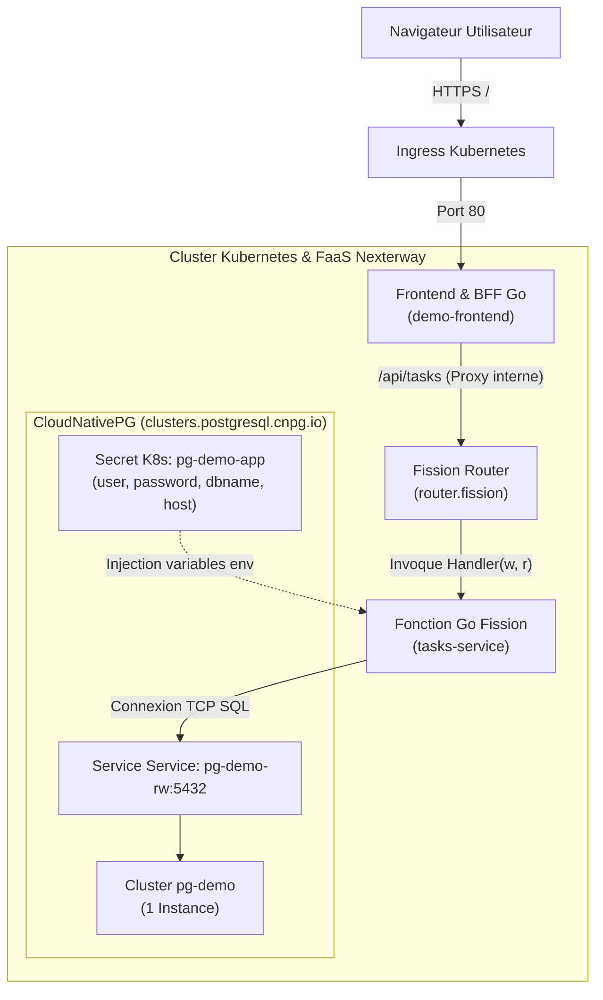

# Démo Complète Full Go : Frontend Web + Fission FaaS + PostgreSQL (CloudNativePG)

Ce projet illustre une architecture applicative complète **100% Go** exécutée sur Kubernetes :
- **Frontend / BFF en Go** : Serveur HTTP compilé en binaire statique Distroless, servant une interface Web moderne (Tailwind CSS) embarquée via `embed.FS` et agissant comme proxy vers le routeur Fission.
- **Fonctions Serverless Fission en Go** : Logique métier événementielle (`tasks-service`) qui reçoit les commandes, effectue les traitements et persiste l'état.
- **Base de données PostgreSQL opérée par CloudNativePG** : 1 instance managée via la CR `clusters.postgresql.cnpg.io`, avec initialisation automatique du schéma SQL (`postInitSQL`) et génération automatique du Secret `pg-demo-app`.

---

## 1. Schéma d'Architecture



---

## 2. Structure du Répertoire

```text
src/demo-complete/
|-- cmd/
|   `-- frontend/
|       `-- main.go              # Serveur HTTP Go (UI embed + Reverse-Proxy Fission + Probes)
|-- web/
|   |-- embed.go                 # Directives go:embed pour les templates et assets statiques
|   |-- templates/
|   |   `-- index.html           # Interface utilisateur Dashboard (Tailwind CSS)
|   `-- static/
|       |-- css/style.css        # Styles et animations complémentaires
|       `-- js/app.js            # Logique client (polling temps réel, formulaires, actions)
|-- pkg/
|   `-- models/
|       `-- task.go              # Structures Go partagées (Task, Status, Stats)
|-- functions/
|   `-- tasks/
|       `-- handler.go           # Handler Fission Go (CRUD + Traitement métier + PostgreSQL)
|-- k8s/
|   |-- cnpg-cluster.yaml        # CRD CloudNativePG (Cluster 1 instance + postInitSQL)
|   |-- frontend-deployment.yaml # Déploiement Kubernetes du Frontend Go
|   |-- frontend-service.yaml    # Service ClusterIP
|   |-- frontend-ingress.yaml    # Ingress HTTP/HTTPS
|   |-- fission-specs.yaml       # Spécifications déclaratives Fission (Package, Function, Trigger)
|   `-- kustomization.yaml       # Fichier d'orchestration Kustomize
|-- Dockerfile                   # Build multi-stage Go vers Distroless non-root
|-- Makefile                     # Commandes de build, test, docker et déploiement
|-- go.mod                       # Définition des modules Go
`-- README.md                    # Ce guide
```

---

## 3. Déclaration GitOps dans Fission (`functions.yaml`)

Pour intégrer cette fonction au pipeline GitOps `nexterway-faas-demo`, ajoutez cette entrée dans le fichier `functions.yaml` à la racine du dépôt :

```yaml
  # ── Démo Complète : Service de tâches connecté à CloudNativePG ──────────────
  - name: tasks-service
    runtime: go
    path: /api/tasks
    method: ANY
    timeout: 30
    file: src/demo-complete/functions/tasks/handler.go
```

La fonction lira automatiquement les informations de connexion PostgreSQL fournies par le secret CloudNativePG (`pg-demo-app`) :
- `DB_HOST`: `pg-demo-rw` (ou `pg-demo-ro`)
- `DB_PORT`: `5432`
- `DB_USER`: `taskuser`
- `DB_NAME`: `taskdb`
- `DB_PASSWORD`: généré automatiquement par CNPG

---

## 4. Déploiement Rapide sur Kubernetes

### Étape 1 : Déployer le cluster PostgreSQL CloudNativePG

```bash
cd src/demo-complete
make deploy-db
```

Vérifiez que l'instance PostgreSQL est active et prête :

```bash
kubectl get cluster.postgresql.cnpg.io pg-demo -w
```

*Dès que le statut passe à `Cluster in healthy state`, CloudNativePG a créé le service `pg-demo-rw` et le secret `pg-demo-app`.*

---

### Étape 2 : Construire et publier l'image du Frontend

```bash
# Personnalisez votre registry d'images si nécessaire
export IMAGE_NAME="ghcr.io/herveleclerc/demo-frontend"
export IMAGE_TAG="v1.0.0"

make docker-build
make docker-push
```

---

### Étape 3 : Déployer l'ensemble des manifests

```bash
make deploy
```

Ou directement avec `kubectl` :

```bash
kubectl apply -k k8s/
```

Vérifiez l'état de l'application :

```bash
make status
```

---

## 5. Test et Utilisation

### Via l'Interface Web
Accédez à l'URL configurée dans l'Ingress (ex: `https://demo-tasks.nexterway.caas.fr` ou via `kubectl port-forward svc/demo-frontend 8080:80`) :
1. Créez une nouvelle tâche avec le formulaire (titre, description, priorité).
2. Observez l'apparition instantanée de la tâche dans le tableau avec le statut `PENDING`.
3. Cliquez sur **"Traiter (FaaS)"** : la fonction Fission s'exécute, applique le calcul/enrichissement métier, et met à jour l'enregistrement dans PostgreSQL en `COMPLETED`.

---

### Via `curl` (API REST)

#### 1. Créer une tâche (POST)
```bash
curl -i -X POST http://localhost:8080/api/tasks \
  -H "Content-Type: application/json" \
  -d '{
    "title": "Génération de rapport mensuel",
    "description": "Calcul des KPIs comptables Odoo",
    "priority": "HIGH"
  }'
```

#### 2. Consulter la liste des tâches et métriques (GET)
```bash
curl -s http://localhost:8080/api/tasks | jq .
```

#### 3. Déclencher le traitement Serverless d'une tâche (POST)
```bash
curl -i -X POST "http://localhost:8080/api/tasks?action=process&id=<TASK_ID>"
```
